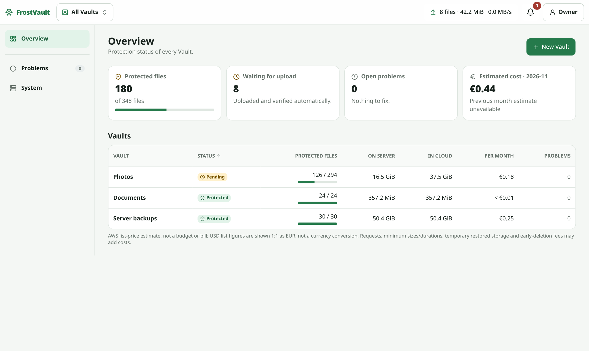
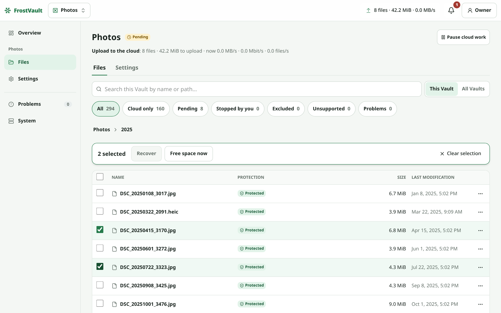
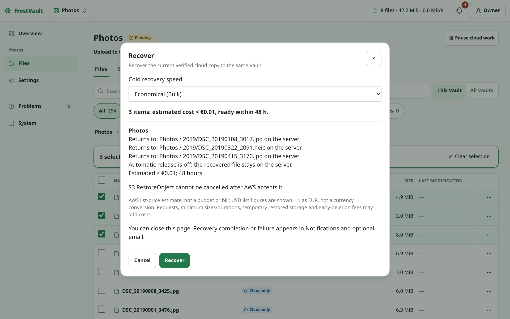
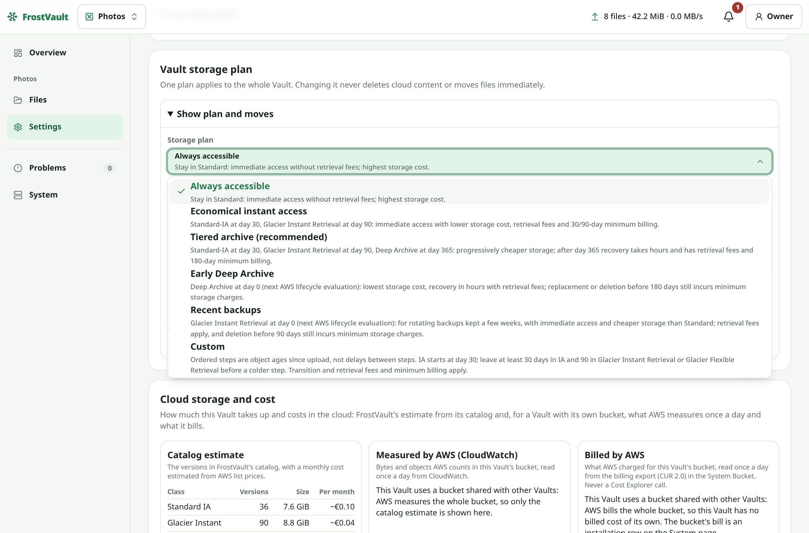
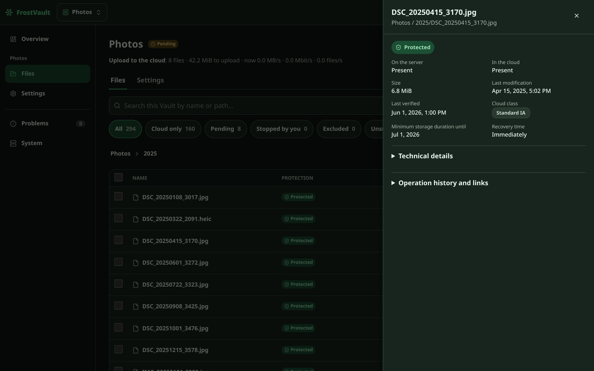
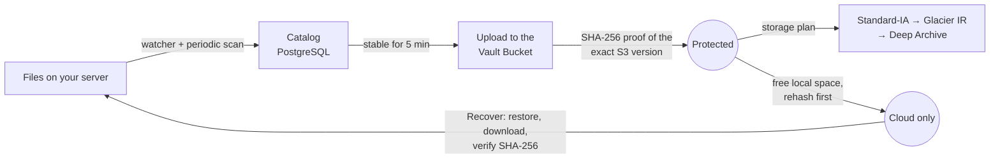

# FrostVault

<p align="center">
  
</p>

<p align="center">
  <strong>Self-hosted cold storage for your server's files.</strong><br>
  FrostVault watches your folders, archives them to Amazon S3, proves every upload
  with SHA-256, frees local space only when it is safe, and recovers the exact bytes.
</p>

<p align="center">
  <a href="https://github.com/PaoloDelCasale/frostvault/actions/workflows/migrations.yml"></a>
  <a href="https://github.com/PaoloDelCasale/frostvault/releases/latest"></a>
  <a href="https://github.com/PaoloDelCasale/frostvault/pkgs/container/frostvault"></a>
  <a href="LICENSE"></a>
  
  
</p>

<p align="center">
  <a href="#features">Features</a> ·
  <a href="#screenshots">Screenshots</a> ·
  <a href="#how-it-works">How it works</a> ·
  <a href="#quick-start">Quick start</a> ·
  <a href="#documentation">Documentation</a>
</p>

<picture>
  <source media="(prefers-color-scheme: dark)" srcset="docs/images/overview-dark.png">
  
</picture>

## Why FrostVault

S3 Glacier Deep Archive costs about a dollar per terabyte per month, which makes
it ideal for photo libraries, documents and server backups that almost never
change. Using them safely is the hard part: knowing what is really in the cloud,
deciding when a local copy can be deleted, and getting the right bytes back months
later.

FrostVault is a small web application you run next to your files (a NAS, an
Unraid server, any Linux box with Docker). It keeps a catalog of every file in
your **Vaults**, uploads new and changed files on its own, and shows a clear
protection state for each one. Nothing is called *Protected* until FrostVault has
proved that the exact content is in S3, and nothing is deleted on the server
until that proof is checked again.

It is a personal archive: one Owner, no accounts to manage, no client-side
encryption to lose keys for. Your files keep their names and bytes in your own
AWS account, readable by any S3 tool even without FrostVault.

## Features

**Automatic, verified protection**
- Real-time folder watching with a stability window, so files are uploaded once
  they stop changing, plus a periodic full scan as a safety net.
- Every upload is proved with an S3 SHA-256 checksum of the exact object version,
  or an optional full read-back. A failed or ambiguous upload never replaces the
  last good copy.
- Clear per-file states: **Protected**, **Pending**, **Cloud only**, **Excluded**,
  **Stopped by you**, **Unconfirmed** and **Problem**, counted on every folder.
- Exclusion and inclusion rules per Vault, with fixed noise exclusions
  (`.DS_Store`, `Thumbs.db`, `*.lock`, …) and a rule tester.

**Cost-aware cloud storage**
- A dedicated, private, versioned S3 bucket for each Vault, created and checked
  by FrostVault.
- Storage plans per Vault, from *Always accessible* to *Tiered archive*
  (Standard-IA → Glacier Instant Retrieval → Deep Archive), and on-demand moves
  of a whole Vault to a colder class.
- Monthly cost estimates from AWS list prices, sizes measured by CloudWatch and the
  real billed cost from the AWS billing export, side by side.
- Minimum storage duration tracking, so you see what an early deletion still costs.

**Safe local space and recovery**
- Free local space by hand or automatically after 3 months to 2 years, only for
  files whose cloud copy is verified; the local file is hashed again just before
  removal.
- Recover single files or whole folders. Cold recoveries show an estimate first,
  use the economical Bulk tier by default, and large ones wait for your approval.
- Conflict protection: if different content appears where a cloud-only file used
  to be, nothing is overwritten until you decide.

**Built for unattended operation**
- Optional S3 Object Lock (Governance mode) per Vault against stolen keys and
  ransomware: FrostVault itself cannot delete a locked version early.
- Cloud deletion always waits seven days and can be cancelled; optional Mirror
  Cleanup for data that is already a backup.
- Encrypted metadata backups to a separate System Bucket and a **Recovery Kit**
  to rebuild everything on a new server.
- Notification center with optional email alerts and a weekly summary.
- Single sign-on with OIDC (for example Pocket ID), an emergency password limited
  to your LAN, responsive UI in English and Italian, light and dark themes.

## Screenshots

<table>
  <tr>
    <td width="50%"><br><sub><b>File browser.</b> Protection state per file and folder, filters, search, bulk actions.</sub></td>
    <td width="50%"><br><sub><b>Recovery.</b> Cold copies come back with an estimate, the return path and a choice of speed.</sub></td>
  </tr>
  <tr>
    <td width="50%"><br><sub><b>Storage plans.</b> One plan per Vault, explained in plain language, with cost per class.</sub></td>
    <td width="50%"><br><sub><b>File details.</b> When it was verified, which class it is in and how fast it comes back.</sub></td>
  </tr>
</table>

## How it works



1. **Observe.** FrostVault watches each Vault folder and records what it sees in
   its catalog. A full scan every six hours catches anything the watcher missed.
2. **Upload.** Once a file has been stable for five minutes it is queued and
   uploaded to the Vault's own S3 bucket, with bounded bandwidth and parallelism.
3. **Verify.** The upload is accepted only when S3's SHA-256 checksum of that exact
   object version matches the bytes that were read. Then the file is *Protected*,
   and only then is the previous cloud copy cleaned up.
4. **Age.** The Vault's storage plan moves objects to cheaper classes over time.
5. **Release.** Freeing local space re-checks the cloud version and re-hashes the
   local file first. The file stays in the catalog as *Cloud only*.
6. **Recover.** FrostVault restores the object from cold storage if needed,
   downloads the exact version, checks its SHA-256 and puts the file back in place.

The full model, including every protection state and upload guarantee, is in
[How FrostVault works](docs/how-it-works.md).

## Quick start

You need Docker with Compose v2, a PostgreSQL 16 database, an AWS account and an
HTTPS reverse proxy (or Tailscale) for anything beyond localhost.

1. **Get the Compose files** and create your configuration:

   ```bash
   git clone https://github.com/PaoloDelCasale/frostvault.git
   cd frostvault
   cp .env.example .env
   ```

2. **Prepare the data directory** with the identity the container runs as. The
   image runs directly as the numeric `PUID:PGID` (default `99:100`, the Unraid
   `nobody:users`) and never creates an account at runtime, so the directory must
   exist with the right owner before the first start. See
   [Compose identity and fresh host data directory](docs/deployment.md#compose-identity-and-fresh-host-data-directory).

   ```bash
   PUID=99
   PGID=100
   mkdir -p ./data
   sudo chown "${PUID}:${PGID}" ./data
   sudo chmod 0750 ./data
   ```

3. **Create the database** (as a PostgreSQL administrator):

   ```sql
   CREATE USER frostvault WITH PASSWORD 'A-LONG-PASSWORD';
   CREATE DATABASE frostvault OWNER frostvault;
   ```

4. **Create an IAM user** with the
   [FrostVault buckets policy](infra/terraform/archive-bucket/iam/frostvault-buckets-policy.json).
   FrostVault creates its own buckets (`frostvault-*`); you do not create one.

5. **Fill in `.env`**: `SOURCES_ROOT` (the host folder mounted at `/sources`),
   the `PG*` database settings, `AWS_ACCESS_KEY_ID`, `AWS_SECRET_ACCESS_KEY`,
   `AWS_DEFAULT_REGION`, an `ARCHIVE_MASTER_KEY` (the command to generate it is in
   `.env.example`), an emergency password in `BOOTSTRAP_ADMIN_*` (at least 12
   characters) and, in `BREAK_GLASS_ALLOWED_CIDRS`, the LAN you will sign in from.
   Values containing `REPLACE` are placeholders.

6. **Start it.** Compose pulls `ghcr.io/paolodelcasale/frostvault:latest`; an empty
   database is initialized on first start.

   ```bash
   docker compose pull
   docker compose up -d
   docker compose logs -f frostvault
   ```

7. **Open** port `8080` (published on `127.0.0.1` only; reach it through your
   reverse proxy or an SSH tunnel), sign in with the emergency password or OIDC,
   create your first Vault and download the Recovery Kit from **System**.

Before archiving terabytes, run the
[recommended first smoke test](docs/deployment.md#recommended-first-smoke-test) on
a folder with two unimportant files. For a network deployment behind Traefik with
OIDC, read [Deployment and operations](docs/deployment.md) and the
[Traefik guide](docs/traefik.md): the app refuses to start in production without
`ALLOWED_HOSTS`, `TRUSTED_PROXIES` and `FORWARDED_ALLOW_IPS`.

### Essential configuration

| Area | Variables |
| --- | --- |
| Folders | `SOURCES_ROOT`, `PUID`, `PGID` |
| Database | `PGHOST`, `PGPORT`, `PGDATABASE`, `PGUSER`, `PGPASSWORD` |
| AWS | `AWS_ACCESS_KEY_ID`, `AWS_SECRET_ACCESS_KEY`, `AWS_DEFAULT_REGION` |
| Sign-in | `OIDC_*`, `BOOTSTRAP_ADMIN_*`, `BREAK_GLASS_ALLOWED_CIDRS` |
| Network | `APP_PORT`, `COOKIE_SECURE`, `ALLOWED_HOSTS`, `TRUSTED_PROXIES`, `FORWARDED_ALLOW_IPS` |
| Backups | `ARCHIVE_MASTER_KEY`, `METADATA_BACKUP_*` |
| Email | `SMTP_*`, `APP_PUBLIC_URL`, `TZ` |

All configuration lives in the environment; there is no settings page to drift
from it. Every variable is described in [Configuration](docs/configuration.md).

## Safety principles

- **Proof before trust.** A file is Protected only after S3 proves the exact
  object version; a missing source volume never turns files into Cloud only.
- **Nothing irreversible by accident.** Local copies are removed only after a fresh
  check, cloud deletion waits seven days, and deletions on the server never reach
  the cloud unless you turn on Mirror Cleanup.
- **Your data stays yours.** Files are stored with their original names and bytes
  in your own buckets, protected by S3 versioning, SSE-S3 and Block Public Access,
  and recoverable with any S3 tool using the Recovery Kit.
- **Small attack surface.** One Owner, OIDC or a LAN-only emergency password,
  read-only root filesystem, no Linux capabilities, diagnostics closed by default.

FrostVault does not replace independent, tested backups. Report vulnerabilities as
described in [SECURITY.md](SECURITY.md).

## Documentation

| Guide | What it covers |
| --- | --- |
| [How FrostVault works](docs/how-it-works.md) | Owner and Vaults, protection states, automatic upload, upload verification |
| [Archive lifecycle and recovery](docs/cloud-lifecycle.md) | Storage plans, Retention Lock, cloud deletion, Mirror Cleanup, freeing space, recovery |
| [Deployment and operations](docs/deployment.md) | Requirements, production setup, healthcheck, diagnostics, shutdown, AWS permissions |
| [Configuration](docs/configuration.md) | Every environment variable, notifications and email |
| [AWS S3 buckets](docs/aws-s3-bucket.md) | Buckets FrostVault creates, storage plans, Object Lock, CloudWatch sizes |
| [Billed cost](docs/billed-cost.md) | Setting up the AWS billing export |
| [Metadata backups](docs/metadata-backups.md) | Encrypted backups, Recovery Kit and manual disaster recovery |
| [Filesystem permissions](docs/filesystem-permissions.md) | `PUID`/`PGID`, Source Volumes, Unraid and Docker Desktop, running as root |
| [Traefik](docs/traefik.md) | Reverse proxy topology, trusted proxies, OIDC over HTTPS |
| [Development](docs/development.md) | Native setup, tests, frontend, CI, translations |
| [Architecture decisions](docs/adr/) | The ADRs behind each design choice |

The domain vocabulary (Vault, Local Copy, Archive Version, …) is defined in
[CONTEXT.md](CONTEXT.md).

## Known limits

- FrostVault is a single self-hosted application, not a managed multi-region service.
- It supports Amazon S3; AWS operations may incur storage, retrieval, request and
  transfer charges, and Glacier restores cannot be cancelled once AWS accepts them.
- There are no previews and no version history: each Vault keeps the last verified
  content of each file.
- Installations from v0.5.x and earlier (including SQLite) need the previous
  release to read their catalog; see
  [older formats and upgrades](docs/metadata-backups.md#older-formats).

## Contributing

Issues and pull requests are welcome. Start with [Development](docs/development.md)
for the native setup with an isolated PostgreSQL 16; CI runs the full Python,
migration, S3-compatible, Playwright and image checks on every pull request.

## License

Licensed under the [Apache License 2.0](LICENSE).
